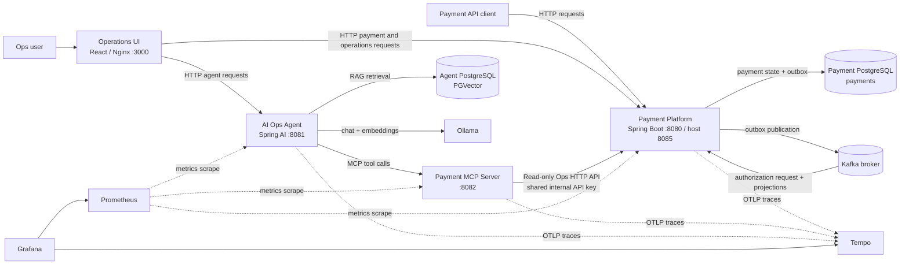
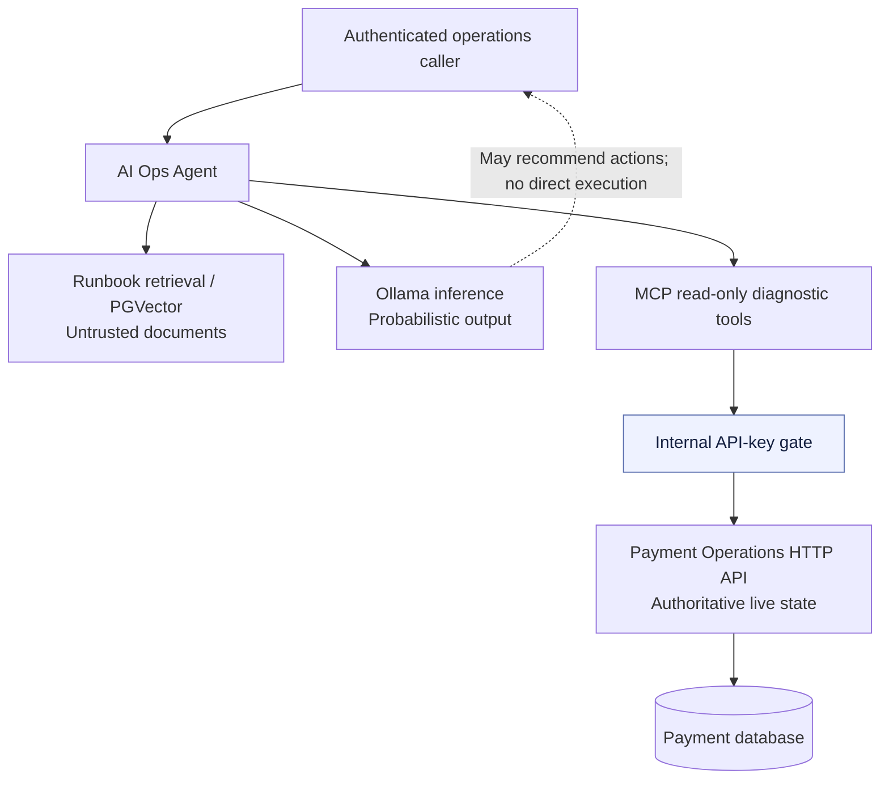

# SentinelPay — Architecture views (Ticket 4)

**Status:** documented from repository snapshot dated 2026-10-11. **Scope:** implementation as observed, not proof of production SLOs.

## C4-style container view



**Deployment facts:** `docker-compose.yml` defines separate `payment-db`, `agent-db`, `kafka`, `payment-platform`, `payment-mcp-server`, `ai-ops-agent`, `ops-ui`, `ollama`, `tempo`, `prometheus` and `grafana` services. Docker Compose is a **single-host development/demo topology**, not a highly available cluster. External bindings: UI 3000, payment 8085, agent 8081, MCP 8082, Kafka 9092, Prometheus 9090, Grafana 3001 in the base compose. `docker-compose.production.yml` adds loopback bindings / required secret configuration, but does not by itself establish public-production security.

## Payment write path and failure boundary

```mermaid
sequenceDiagram
    autonumber
    participant Client
    participant API as Payment API
    participant DB as Payment PostgreSQL
    participant Outbox as Outbox Publisher
    participant K as Kafka
    participant C as Payment consumer
    participant P as Mock payment provider
    Client->>API: POST /api/payments (idempotency)
    API->>DB: Commit payment + outbox atomically
    API-->>Client: API response
    loop Scheduled publishing
      Outbox->>DB: Lock pending rows (SKIP LOCKED)
      Outbox->>K: Publish event
      Outbox->>DB: Mark publish outcome
    end
    K-->>C: Authorization event (may redeliver)
    C->>P: Authorize through provider abstraction
    C->>DB: State update + event / projections
    Note over K,DB: At-least-once delivery; idempotency required
```

The payment platform includes the consumers and projections in **one deployable**; the Kafka arrows do not imply separate consumer services. The existing provider adapter is `DeterministicMockPaymentProvider`, not an integrated real PSP. Publisher code uses `FOR UPDATE SKIP LOCKED` and the core uses PostgreSQL transactions. Do **not** claim globally exactly-once effects.

## AI evidence / trust-boundary view



**Trust rules:** the AI runtime does not own payment writes, provider keys or direct payment DB access. Retrieved content and LLM responses are untrusted; decisions remain in deterministic application code. Any future mutating MCP tool requires a separate authorization and approval ADR. Do not infer that all exposed HTTP ports are authenticated merely because the current tool methods are read-only.

## Source map

- `docker-compose.yml`, `docker-compose.production.yml`: runtime boundaries and ports.
- `payment-platform/src/main/java/com/acme/payments/{application,messaging,ledger,webhook,adapter}`: domain orchestration, outbox and projections.
- `payment-platform/src/main/java/com/acme/payments/ops/OpsQueryController.java`: live Ops query boundary.
- `payment-mcp-server/src/main`: MCP read-only HTTP gateway.
- `ai-ops-agent/src/main`: agent, knowledge retrieval, MCP client and authorization.
- `infra/prometheus/prometheus.yml`, `infra/tempo/tempo.yml`, `.github/workflows/ci.yml`: telemetry and delivery.
- See `docs/adr/0001-*.md` through `0004-*.md`, `docs/architecture.md`, `docs/ci-cd-deployment.md`.
