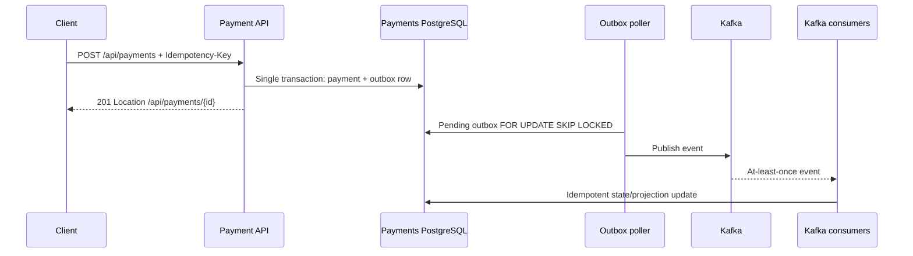

# SentinelPay — System Design Case Study (Ticket 5)

## Problem

Design a payment operations demo that persists payment intent safely, processes asynchronous authorization and projections, provides debugging visibility, and lets an AI assistant investigate incidents **without** granting it payment write permissions.

## Constraints and current implementation

Java 21 / Spring Boot 4, payment PostgreSQL, Flyway, Kafka, independent AI Ops Agent + PGVector/RAG + Ollama, read-only Payment MCP Server, Prometheus/Grafana/Tempo, Docker Compose. This is a single-host demonstration architecture, **not** HA production or a real PSP integration. `DeterministicMockPaymentProvider` simulates provider outcomes.

## Key design decisions

| Decision | Why | Trade-off |
|---|---|---|
| Atomic payment + transactional outbox (`docs/adr/0002-transactional-outbox.md`) | Keep business state and intent-to-publish in one DB transaction | Background poller and operational backlog monitoring |
| Kafka at-least-once + idempotent projections (`docs/adr/0003-at-least-once.md`) | Event replay does not require impossible distributed exactly-once promises | Consumers must tolerate duplicate deliveries |
| Read-only MCP boundary (`docs/adr/0004-ai-read-only-operations-boundary.md`) | LLM cannot execute payment writes | Some incidents require a human operator |
| B3 Flyway baseline (`docs/adr/0005-baseline-migration-legacy-compatibility.md`) | Fresh installs work while retaining historical V1–V3 checksums | New/future changes must target common V4+ chain |
| Resilience4j read-side calls (`docs/adr/0007-mcp-resilience-and-write-isolation.md`) | Bounded transient read failures | No blind retry for non-idempotent provider writes |
| Compose CI image publication (`docs/adr/0006-compose-ci-cd-deployment-boundary.md`) | Reproducible developer/demo deployment | No orchestrator failover or infra SLA |

## Request/data flow

The platform API and consumers are in one deployable process; arrows are logical boundaries, not additional services.

## Failure model and operational response

- **DB down:** fail payment state changes rather than acknowledging uncommitted writes. Recover PostgreSQL, validate DB/Flyway before restarting workers.
- **Kafka down:** outbox keeps pending events; after broker recovery publisher retries. Watch backlog and verify no double effects.
- **Duplicate Kafka event:** idempotency/unique constraints protect ledger/webhook projections; verify with Testcontainers replay.
- **Provider timeout:** outcome may be ambiguous; do not automatically replay unsafe writes. Reconcile via provider idempotency key/status when a real PSP is introduced.
- **MCP/Agent/Ollama down:** diagnostic AI degrades, core Payment API remains independent. Internal Ops data is authoritative.
- **Bad migration:** preserve successful version history/checksums; stop rollout on validate failure, no blind `repair`.

Detailed matrix: `docs/failure-scenarios.md`; runbooks: `docs/runbooks/`.

## Observability and SLI ownership

Prometheus scrapes all three Spring services and Grafana provisions Prometheus/Tempo. Trace/log correlation supports incident reconstruction, but availability or p95 SLO attainment **has not been demonstrated**. Proposed indicators and smoke steps in `docs/monitoring-sli-slo.md`.

## Scaling and readiness limits

At-least-once Kafka processing and DB locking support safer recovery, not infinite throughput. Scale tests must characterize connection pool, Kafka consumer lag, outbox age, and HTTP p95/p99. Before real production: HA and backups, PSP reconciliation, authN/authZ/secret lifecycle, monitoring alerts and DR targets, ingress/TLS, SCA scan and a real load benchmark.

## Interview-ready summary

"I designed a payment platform that commits payment state and its outbox event atomically, then uses Kafka with at-least-once semantics and idempotent consumers. The AI layer is intentionally read-only and retrieves live evidence through MCP instead of mutating payments. The main trade-offs are asynchronous consistency and operational complexity, so I added tracing, Prometheus, runbooks and an explicit failure model. It remains a demo: SLOs, provider behavior and HA require validation before production."

## Verification / rollback

Check `mvn clean verify`, integration tests, API contract tests and `scripts/verify-observability.ps1` on a Docker host. No app/schema modification in Ticket 5; revert documentation and smoke script if required.
